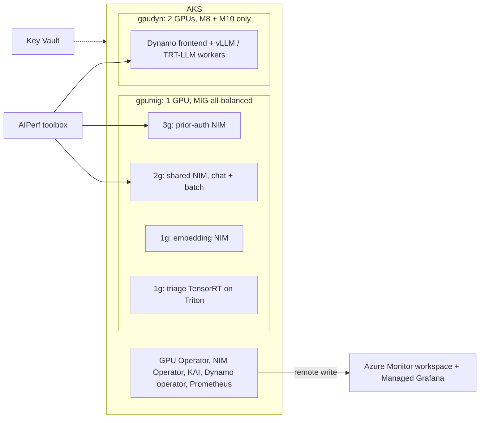

# Lab 02 - Multi-tenant GenAI inference on AKS with the NVIDIA stack

**Customer:** Kestrel Health Alliance (fictional payer-provider) · **GPUs:** 1x A100 80GB or H100 NVL, MIG-partitioned,
plus a 2-GPU pool for Dynamo · **Time:** ~25 hours in 13 modules · **Budget:** ~$105-130 on Spot, ~$180-225 pay-as-you-go (see [Cost](#cost))

You are the NVIDIA solutions architect. KHA runs three generative-AI workloads on four under-used GPUs, suffered a
time-slicing incident during open enrollment, and wants one platform with SLOs, chargeback, and energy numbers. You
size it from first principles, build it on AKS with the NVIDIA stack, prove it with measurements, break it on
purpose, and present it to executives. Every module ends with a **Check** you must pass.

> Synthetic data only. Nothing in this lab touches PHI.

## The problem in one table

| Workload | Traffic shape | SLO |
|---|---|---|
| Prior-auth clinical summarizer (Utilization Management) | ~6,000 tokens in / 350 out; policy text shared across requests | TTFT p95 <= 1.5 s, ITL p95 <= 60 ms at 12 concurrent |
| Member services chat | ~600 in / 200 out; 5x open-enrollment spikes | TTFT p95 <= 0.8 s, ITL p95 <= 50 ms at 32 concurrent |
| Claims note coder (overnight batch) | ~1,200 in / 150 out; 50k notes per night | Done by 6 a.m.; never hurts the other two |
| Policy embeddings + urgency triage classifier | small supporting models | share the same GPU |

Stakeholders, requirements, and discovery questions: [docs/01-customer-brief.md](docs/01-customer-brief.md)

## What you build



Design decisions and rejected alternatives (9 ADRs): [docs/02-architecture-and-adrs.md](docs/02-architecture-and-adrs.md)

## Job-description coverage (JR2015676 - Sr. Solutions Architect, GenAI Deployment & AIOps)

| The posting asks for | Module | Evidence you walk away with |
|---|---|---|
| Trusted technical advisor; proofs of concept with lighthouse customers | M0, M12 | Discovery questions, ADRs, one-page executive readout |
| Help customers adopt NVIDIA technology and MLOps practices | M4, M9 | NIM Operator lifecycle, queue-depth autoscaling, upgrade/rollback, CI performance gate |
| Performance **and power efficiency** of inference on Kubernetes | M3, M7, M10 | Bandwidth probe, latency-throughput curves, tokens/J, kWh and $ per 1,000 decisions |
| GPU orchestration and **MIG** management/debugging in Kubernetes | M2, M8, M11 | One-command mode switcher, noisy-neighbor evidence, KAI queues, 10 break-fix drills |
| Containerization, orchestration, monitoring, observability | M1, M2, M6 | Bicep, Helm, DCGM, PrometheusRules, Grafana, Azure Monitor remote write |
| Theory and practice of LLM / DL inference | M0, M3, M7, M10 | Written predictions vs. measurements, prefix caching, KV-aware routing |
| Python; PyTorch | `bench/`, M5 | Benchmark + energy tooling; PyTorch fine-tune with ONNX export |
| Stand out: NIM, Dynamo, TensorRT, TensorRT-LLM | M4, M5, M10 | NIM on MIG, TensorRT engine on Triton, Dynamo KV router + disaggregation, TRT-LLM backend |
| Stand out: C/C++, parallel programming, performance analysis | M3 | CUDA C++ kernel that measures HBM bandwidth per MIG slice |
| Stand out: distributed systems | M10 | Disaggregated prefill/decode with NIXL; KV-event-driven routing |
| Stand out: DL training at scale | - | **Not covered** - this is an inference lab. See Q12 in [docs/05](docs/05-interview-drill.md) |

## Before you start

**Accounts**
1. Azure subscription where you can create resource groups and role assignments (Owner, or Contributor + User Access Administrator).
2. NGC API key - NVIDIA Developer Program membership covers NIM for development and testing.
3. Hugging Face token, with the Llama 3.1 license accepted on the `meta-llama/Llama-3.1-8B-Instruct` model page (the benchmark tokenizer needs it).

**GPU quota** - `scripts/preflight.sh` prints what you have. Spot pools use *Total Regional Low-priority vCPUs*;
Regular pools use the GPU family quota.

| Phase | A100 vCPUs | H100 NVL vCPUs |
|---|---|---|
| M1-M7, M11 (MIG pool) | 24 | 40 |
| + 2-GPU pool (M8 part F, M10) | +48 | +80 |
| + autoscaled second MIG node (M9) | +24 | +40 |

Short on quota? Remove the 2-GPU pool before M9 (`infra/deploy-landing-zone.sh remove-dynamo-pool`) and add it back for M10.

**Tools (macOS)**
```bash
brew install azure-cli kubernetes-cli helm jq gettext python
az login && az bicep install
```
Scripts are bash 3.2-compatible (the macOS default). Run everything from the repo root; zsh is fine for your own shell.

**Setup**
```bash
cp env/lab.env.example env/lab.env     # set SUBSCRIPTION_ID, NGC_API_KEY, HF_TOKEN; choose GPU_PROFILE and GPU_PRIORITY
source env/lab.env
scripts/preflight.sh
```

## Cost

Prices: Azure Retail Prices API, eastus, 2026-09-28. Hours assume you pause between sessions.

| Item | PAYG $/h | Spot $/h | Planned | Spot total | PAYG total |
|---|---|---|---|---|---|
| NC24ads_A100_v4 - MIG pool | 3.673 | 0.6788 | ~18 h | ~$12 | ~$66 |
| NC48ads_A100_v4 - 2-GPU pool | 7.346 | 1.3575 | ~5 h | ~$7 | ~$37 |
| Second MIG node (M9 autoscale) | 3.673 | 0.6788 | ~0.5 h | <$1 | ~$2 |
| System pool, 2x D8ds_v5 | 0.904 | - | ~30 h | ~$27 | ~$27 |
| Always-on while the lab exists: 300 GiB premium file shares ($1.60/day), managed disks ($1.95/day), Managed Grafana Standard ($1.02/day: $0.0342/node-hour + $6 per active user-month), Azure Monitor + Key Vault (~$0.50/day) | - | - | ~14 days | ~$71 | ~$71 |
| **Total (A100)** | | | | **~$105-130** | **~$180-225** |

H100 NVL: multiply the GPU rows by ~1.9 (NC40ads_H100_v5: $6.98 PAYG / $1.2899 Spot).

The always-on row grows with calendar days, not hours worked: finishing in one week instead of two saves about $35.

Three rules: `infra/deploy-landing-zone.sh pause` at the end of **every** session (stops all nodes; disks, file
shares, and Grafana keep billing); `infra/teardown.sh` when you finish; and if the budget is tight, delete Managed
Grafana after M6 (`az grafana delete -g $RG -n $GRAFANA_NAME`).

## Two ways through

- **Fast path (~10 h, the interview essentials):** M0 -> M1 -> M2 -> M4 -> M7 -> M8 (parts A, B) -> M11 (drills 1, 4, 7, 9) -> M12.
- **Full path (~25 h):** every module in order.

Every module: **Do** the steps, pass the **Check**, fill your table in [docs/04](docs/04-results-and-exec-readout.md),
and practice the matching lines in [docs/05](docs/05-interview-drill.md).

---

## M0 - Frame the problem (no cloud; 1-2 h)
1. Read [docs/01](docs/01-customer-brief.md). Add three discovery questions of your own.
2. Work through [docs/03-sizing-worksheet.md](docs/03-sizing-worksheet.md) and fill in **Your predictions** before measuring anything.
3. Read ADR-01 to ADR-05 and write down one you would argue against, and why.

**Check:** without notes, explain (a) why member chat on an A100 2g slice likely can't reach 32 concurrent chats and
(b) why prior-auth needs prefix caching on an A100 3g slice.

## M1 - Landing zone (45 min; GPU billing starts)
```bash
source env/lab.env
infra/deploy-landing-zone.sh up          # RG + Bicep (AKS, Key Vault, Azure Monitor workspace, Grafana) + MIG GPU pool
kubectl get nodes -L kha.io/pool,kubernetes.azure.com/scalesetpriority
```
**Check:** 2 system nodes + 1 GPU node; the GPU node carries taint `nvidia.com/gpu=present:NoSchedule`; the script's
last output shows the pool's GPU driver is `None` (the GPU Operator will own it). Spot allocation failed? Set
`GPU_PRIORITY=Regular` and rerun.

## M2 - GPU Operator, MIG, DCGM (1 h)
```bash
platform/install-observability.sh        # first: Prometheus CRDs, adapter, KHA rules + dashboard
platform/install-gpu-operator.sh         # driver + toolkit + MIG all-balanced (may reboot the node once)
platform/set-gpu-mode.sh status
kubectl -n gpu-operator exec ds/nvidia-driver-daemonset -- nvidia-smi -L
kubectl -n gpu-operator port-forward svc/nvidia-dcgm-exporter 9400:9400 &
curl -s localhost:9400/metrics | grep -E '^DCGM_FI_DEV_(POWER_USAGE|TOTAL_ENERGY)' | head -4; kill %1
kubectl -n gpu-operator get configmap | grep mig-config      # the geometries MIG Manager generated
```
**Check:** `mig_state` is `success` and allocatable shows `mig-3g.40gb: 1`, `mig-2g.20gb: 1`, `mig-1g.10gb: 2`
(H100 NVL: `3g.47gb`, `2g.24gb`, `1g.12gb` - if the names differ, fix `env/gpu-h100.env`). `nvidia-smi -L` lists 4 MIG devices.

## M3 - Measure the physics in CUDA C++ (45 min)
Run this before M4, while the slices are empty.
```bash
kubectl create namespace kha-bench --dry-run=client -o yaml | kubectl apply -f -
kubectl -n kha-bench create configmap bw-probe --from-file=workloads/physics/bandwidth_probe.cu --dry-run=client -o yaml | kubectl apply -f -
scripts/render.sh workloads/physics/bandwidth-jobs.yaml | kubectl apply -f -
kubectl -n kha-bench wait --for=condition=complete job -l app=bw-probe --timeout=20m
for j in large medium small; do kubectl -n kha-bench logs job/bw-probe-$j | tail -2; done
```
**Check:** read bandwidth falls roughly 4:2:1 across 3g:2g:1g even though their SM counts are 3:2:1 - explain why
(bandwidth follows memory slices, compute follows compute slices). Compare the printed decode floors with the worksheet.

## M4 - NIM Operator and the tenants (1.5 h, mostly downloads)
```bash
platform/install-nim-operator.sh
scripts/render.sh workloads/namespaces.yaml | kubectl apply -f -
workloads/create-secrets.sh                                   # Key Vault -> namespaces
scripts/render.sh workloads/nim/nimcache-llama.yaml workloads/nim/nimcache-embed.yaml | kubectl apply -f -
kubectl get nimcache -A -w                                    # Ready in ~10-20 min
scripts/render.sh workloads/nim/nimservice-priorauth.yaml workloads/nim/nimservice-shared.yaml \
  workloads/nim/nimservice-embed.yaml | kubectl apply -f -
kubectl get nimservice -A -w                                  # Ready in ~5-15 min
```
Start the benchmark toolbox (used from here on) and smoke-test every endpoint:
```bash
kubectl -n kha-bench create configmap bench-code --from-file=bench/prefix_workload.py \
  --from-file=workloads/triage/triage_client.py --dry-run=client -o yaml | kubectl apply -f -
scripts/render.sh bench/toolbox.yaml | kubectl apply -f -
kubectl -n kha-bench rollout status deploy/bench-toolbox --timeout=20m
alias tb='kubectl -n kha-bench exec deploy/bench-toolbox --'
tb curl -s http://priorauth-llm.kha-um.svc:8000/v1/models
tb curl -s http://priorauth-llm.kha-um.svc:8000/v1/chat/completions -H 'Content-Type: application/json' \
  -d '{"model":"meta/llama-3.1-8b-instruct","messages":[{"role":"user","content":"In two sentences, what is prior authorization?"}],"max_tokens":80}'
tb curl -s http://policy-embed.kha-shared.svc:8000/v1/embeddings -H 'Content-Type: application/json' \
  -d '{"model":"nvidia/llama-nemotron-embed-1b-v2","input":["knee arthroplasty coverage criteria"],"input_type":"query"}' | head -c 300
kubectl -n kha-um logs deploy/priorauth-llm | grep -i -E 'profile|max_model_len|kv cache' | head
tb curl -s http://priorauth-llm.kha-um.svc:8000/v1/metrics | grep -o '^vllm:[a-z_]*' | sort -u
```
**Check:** three NIMServices Ready; the logs name the profile (`vllm-bf16-tp1-pp1` on A100) and the KV-cache size.
If `shared-llm` fails on the A100 2g slice, you are watching worksheet prediction C happen - read the vLLM error
first, then compare with drill 7.

## M5 - Triage model: PyTorch -> ONNX -> TensorRT -> Triton (1.5 h)
```bash
kubectl -n kha-shared create configmap triage-code --from-file=workloads/triage/ --dry-run=client -o yaml | kubectl apply -f -
scripts/render.sh workloads/triage/triage-pvc.yaml workloads/triage/triage-jobs.yaml | kubectl apply -f -
kubectl -n kha-shared logs -f job/triage-data                    # ~15-25 min: 1,200 labeled synthetic notes from the NIM
kubectl -n kha-shared logs -f job/triage-train-build -c train    # fine-tune, ONNX export, PyTorch eager baseline
kubectl -n kha-shared logs -f job/triage-train-build -c build    # TensorRT engine build + trtexec numbers
scripts/render.sh workloads/triage/triton.yaml | kubectl apply -f -
kubectl -n kha-shared rollout status deploy/triage-triton
scripts/render.sh workloads/triage/triage-perf-job.yaml | kubectl apply -f -
kubectl -n kha-shared logs -f job/triage-perf                    # perf_analyzer sweep vs. PyTorch baseline
tb python3 /code/triage_client.py "Post-op patient with spreading wound redness and fever; home IV antibiotics needed before discharge tomorrow."
```
**Check:** you can state the TensorRT speed-up over PyTorch eager at batch 8, and explain optimization profiles
(min/opt/max shapes) and why an engine is tied to its GPU architecture and TensorRT version. (Accuracy will look
high - the data is synthetic; the point is the pipeline.)

## M6 - Observability, in-cluster and in Azure (1 h)
```bash
az keyvault secret show --vault-name "$KV_NAME" -n grafana-admin-password --query value -o tsv
kubectl -n monitoring port-forward svc/kps-grafana 3000:80 &          # http://localhost:3000  (admin)
kubectl -n monitoring port-forward svc/kps-prometheus 9090:9090 &     # keep this running for M7-M10
platform/enable-azure-monitor-remote-write.sh                          # managed identity -> Azure Monitor; dashboard -> Managed Grafana
echo "$GRAFANA_ENDPOINT"
```
Open the **KHA GenAI Inference** dashboard. In Prometheus (Status -> Targets) confirm DCGM exporter, all three
NIMServices, and Triton are up. While member chat is under load, compare `DCGM_FI_PROF_DRAM_ACTIVE` with
`DCGM_FI_PROF_PIPE_TENSOR_ACTIVE` - that is memory-bound decode, visible.

**Check:** `kha:gpu_power_watts` appears in Azure Managed Grafana within ~10 minutes; you can explain `honorLabels`
on the DCGM ServiceMonitor and why there are two observability tiers (ADR-04).

## M7 - Performance and power analysis (2-3 h)
Keep the Prometheus port-forward on 9090 - energy and cost come from it.
```bash
bench/run_sweep.sh priorauth "1 2 4 8 12 16 24"
bench/run_sweep.sh member "1 4 8 16 24 32"
bench/run_sweep.sh batch "16 32 64"
```
Each run prints per-level req/s, TTFT and ITL p50/p95, **SLO attainment** (AIPerf goodput), average GPU watts,
tokens/J, kWh and $ per 1,000 requests; the full CSV is in `results/<run>/summary.csv`. Choose each tenant's
operating point - the highest concurrency with SLO attainment >= 95% - then price it:
```bash
python3 bench/cost_model.py --node-hourly "$GPU_HOURLY_USD" --slice-share 0.4286 --req-per-s <from sweep> \
  --isl 6000 --osl 350 --duty-cycle 0.5 --api-in-per-1m <your price> --api-out-per-1m <your price>
```
Test prediction B - prefix caching on vs. off, with ~half of each prompt shared policy text:
```bash
tb python3 /code/prefix_workload.py --out /results/prefix-llama.jsonl --policies 24 --requests 400 --policy-words 2300 --case-words 2000
bench/run_sweep.sh prefix-priorauth "4 8 12"                                   # caching ON (default)
export PRIORAUTH_CACHE_FLAG="--no-enable-prefix-caching"
scripts/render.sh workloads/nim/nimservice-priorauth.yaml | kubectl apply -f -
kubectl -n kha-um rollout status deploy/priorauth-llm --timeout=30m
bench/run_sweep.sh prefix-priorauth "4 8 12"                                   # caching OFF
export PRIORAUTH_CACHE_FLAG="--enable-prefix-caching"
scripts/render.sh workloads/nim/nimservice-priorauth.yaml | kubectl apply -f -
```
H100 NVL extra: copy `nimcache-llama.yaml` under a new name with `precision: bf16`, point a copy of the prior-auth
NIMService at it, and compare FP8 vs. BF16 tokens/J at the same SLO.

**Check:** for each tenant you can name the operating point, its $ and kWh per 1,000 decisions, and whether
predictions A, B, and C held - and why or why not.

## M8 - Isolation and GPU orchestration (2-3 h)
**A. MIG under a noisy neighbor**
```bash
bench/noisy_neighbor.sh mig
```
**B. Time-slicing** - same tenants, whole-GPU requests, no hardware isolation
```bash
kubectl -n kha-um delete nimservice priorauth-llm
kubectl -n kha-shared delete nimservice shared-llm policy-embed
kubectl -n kha-shared scale deploy/triage-triton --replicas=0
platform/set-gpu-mode.sh ts
scripts/render.sh workloads/isolation/nimservices-fullgpu.yaml | kubectl apply -f -
kubectl get nimservice -A -w
bench/noisy_neighbor.sh timeslice
```
**C. MPS (optional)**
```bash
kubectl -n kha-um delete nimservice priorauth-llm-fg; kubectl -n kha-shared delete nimservice shared-llm-fg
platform/set-gpu-mode.sh mps
scripts/render.sh workloads/isolation/nimservices-fullgpu.yaml | kubectl apply -f -
bench/noisy_neighbor.sh mps
```
**D. Full-GPU reference**
```bash
kubectl -n kha-um delete nimservice priorauth-llm-fg; kubectl -n kha-shared delete nimservice shared-llm-fg
platform/set-gpu-mode.sh full
scripts/render.sh workloads/physics/bandwidth-job-full.yaml | kubectl apply -f -
kubectl -n kha-bench wait --for=condition=complete job/bw-probe-full --timeout=20m && kubectl -n kha-bench logs job/bw-probe-full | tail -2
scripts/render.sh workloads/isolation/nimservices-fullgpu.yaml | kubectl apply -f -
kubectl -n kha-shared delete nimservice shared-llm-fg                          # only one exclusive GPU
bench/run_sweep.sh priorauth-fg "1 4 8 12"
```
**E. Back to MIG**
```bash
kubectl -n kha-um delete nimservice priorauth-llm-fg --ignore-not-found
platform/set-gpu-mode.sh mig
scripts/render.sh workloads/nim/nimservice-priorauth.yaml workloads/nim/nimservice-shared.yaml \
  workloads/nim/nimservice-embed.yaml | kubectl apply -f -
kubectl -n kha-shared scale deploy/triage-triton --replicas=1
```
**F. KAI Scheduler: guaranteed quota and reclaim** (2-GPU pool)
```bash
infra/deploy-landing-zone.sh add-dynamo-pool
platform/set-gpu-mode.sh status dynamo           # repeat until nvidia.com/gpu: 2 appears (~10-15 min)
platform/install-kai-scheduler.sh
scripts/render.sh workloads/kai/kai-demo.yaml | kubectl apply -f -
kubectl -n kha-kai-demo get pods -o wide         # batch borrows BOTH idle GPUs (over quota)
scripts/render.sh workloads/kai/kai-demo-um.yaml | kubectl apply -f -
kubectl -n kha-kai-demo get pods -w              # KAI reclaims one GPU for the UM queue
kubectl -n kha-kai-demo get events --sort-by=.lastTimestamp | tail -15
kubectl delete namespace kha-kai-demo            # frees the pool for M10
```
**Check:** the M8 table is filled, and you can explain each mode's result and when you would still choose
time-slicing (dev/test, bursty non-SLO work) or MPS (cooperative small models, one owner).

## M9 - Autoscaling, cold start, upgrades, CI gate (1.5 h)
```bash
kubectl get --raw "/apis/custom.metrics.k8s.io/v1beta1/namespaces/kha-shared/pods/*/vllm_num_requests_waiting"
scripts/render.sh workloads/nim/nimservice-shared-hpa.yaml | kubectl apply -f -
infra/deploy-landing-zone.sh autoscale-mig on
bench/run_sweep.sh member "96"                   # queue builds -> HPA wants 2 -> no free 2g slice -> new GPU node
# second terminal:  kubectl -n kha-shared get hpa -w      third terminal:  kubectl get nodes -w
NEW_POD="$(kubectl -n kha-shared get pods --sort-by=.metadata.creationTimestamp -o name | grep shared-llm | tail -1 | cut -d/ -f2)"
python3 bench/coldstart_timeline.py -n kha-shared "$NEW_POD"
infra/deploy-landing-zone.sh autoscale-mig off
```
**Upgrade pattern (NIM Operator):** create a new NIMCache for the new image tag, point the NIMService at it (image
tag + cache name), let it roll; rollback = revert both. Gate the change with the performance check:
```bash
cp results/<member run>/c16/profile_export_aiperf.json bench/baselines/member-c16.json
bench/run_sweep.sh member "16"
python3 bench/perf_gate.py --baseline bench/baselines/member-c16.json --candidate results/<new run>/c16
```
`.github/workflows/perf-gate.yml` runs the same gate from GitHub Actions (OIDC to Azure).

**Check:** the cold-start table is filled; you can explain why queue depth beats GPU utilization as a scaling signal
and why open enrollment needs scheduled pre-scaling.

## M10 - Dynamo: KV-aware routing, disaggregation, TensorRT-LLM (3 h, 2-GPU pool)
```bash
infra/deploy-landing-zone.sh add-dynamo-pool      # skip if it still exists from M8-F
platform/install-dynamo.sh
workloads/create-secrets.sh                       # hf-token-secret in kha-dynamo
scripts/render.sh dynamo/model-cache.yaml | kubectl apply -f -
kubectl -n kha-dynamo wait --for=condition=complete job/qwen3-download --timeout=40m
kubectl -n kha-dynamo delete job qwen3-download   # the cache PVC stays
tb python3 /code/prefix_workload.py --out /results/prefix-qwen3.jsonl --policies 48 --requests 800
dyn() { scripts/render.sh "dynamo/$1.yaml" | kubectl apply -f - && sleep 45 && kubectl -n kha-dynamo wait --for=condition=Ready pod --all --timeout=40m; }
dyn qwen3-agg-rr;     bench/run_sweep.sh dynamo:qwen3-agg-rr "16";     kubectl -n kha-dynamo delete dgd qwen3-agg-rr
dyn qwen3-agg-kv;     bench/run_sweep.sh dynamo:qwen3-agg-kv "16";     kubectl -n kha-dynamo delete dgd qwen3-agg-kv
dyn qwen3-disagg;     bench/run_sweep.sh dynamo:qwen3-disagg "16";     kubectl -n kha-dynamo delete dgd qwen3-disagg
dyn qwen3-trtllm-agg; bench/run_sweep.sh dynamo:qwen3-trtllm-agg "16"; kubectl -n kha-dynamo delete dgd qwen3-trtllm-agg
infra/deploy-landing-zone.sh remove-dynamo-pool
```
Prefix-cache hit rate per run: `kubectl -n kha-dynamo logs <worker-pod> | grep -i "prefix cache hit rate" | tail -1`.
If `dgd` isn't recognized as a short name, use `dynamographdeployment`.

**Check:** the M10 table is filled; you can explain the KV-router gain (48 policies don't fit in each worker's KV
cache, so round-robin keeps evicting shared prefixes), why disaggregation lost on NC-series (no RDMA fabric for KV
transfer), and why the engine comparison uses equal KV-cache size rather than equal memory flags.

## M11 - Break-fix drills (2 h)
Follow [drills/README.md](drills/README.md): `drills/inject.sh <n>`, diagnose from symptoms, `drills/inject.sh reset <n>`.
Suggested order: 1, 5, 6, 10, 4, 7, 8, 9, then the MIG relabel drills 2 and 3.

**Check:** every drill diagnosed in under 10 minutes, with a runbook note in docs/04.

## M12 - Executive readout and portfolio (2 h, no cloud)
1. Fill the one-page readout in [docs/04](docs/04-results-and-exec-readout.md) from your results.
2. Record a 5-minute walkthrough: dashboard, noisy-neighbor result, $ and kWh per 1,000 decisions, recommendation.
3. Push to GitHub (`env/lab.env` and raw `results/` are git-ignored; commit summaries only).
4. Write one post from your data, e.g. "What MIG actually isolates: measurements from one A100".
5. Practice [docs/05](docs/05-interview-drill.md) out loud until it needs no notes.

## Pause and teardown
```bash
infra/deploy-landing-zone.sh pause      # end of every session (az aks stop)
infra/deploy-landing-zone.sh resume     # next session
infra/teardown.sh                       # when you're done
```

---

## Versions (verified 2026-09-28) and drift you will hit

| Component | Pinned | Watch out for |
|---|---|---|
| AKS GPU pools | `--gpu-driver none` | `--skip-gpu-driver-install` was retired Aug 2025; NVIDIA's AKS page still shows it |
| GPU Operator | v26.7.1 | Operator-managed mode needs driver **and** toolkit enabled; never mix with AKS-managed drivers |
| NIM Operator | 3.1.2 | `apps.nvidia.com/v1alpha1` NIMCache/NIMService; `replicas` is forbidden when `scale.enabled` |
| NIM LLM | `llama-3.1-8b-instruct-pb6:2.0.4-pb6.7` | 2.x profiles are vLLM-only; PB6 needs `groupID: 0`; engine args via `NIM_PASSTHROUGH_ARGS`; metrics at `/v1/metrics` |
| Embedding NIM | `llama-nemotron-embed-1b-v2:1.13.0` | renamed from `llama-3.2-nv-embedqa-1b-v2` |
| Dynamo | 1.5.0 | DGD `nvidia.com/v1beta1` with `spec.components`; no NATS/etcd needed by default |
| KAI Scheduler | v0.18.0 | CNCF sandbox; queues are `scheduling.run.ai/v2` |
| AIPerf | 0.13.0 | replaces genai-perf; `--goodput` reports SLO attainment |
| kube-prometheus-stack / prometheus-adapter | 91.8.1 / 5.3.0 | vLLM metric renames (`gpu_cache_usage_perc` -> `kv_cache_usage_perc`, `time_per_output_token` -> `inter_token_latency`); the recording rules accept both |
| NGC containers | 26.08 (Triton, PyTorch, TensorRT) | build and serve TensorRT engines with the same release |
| CUDA | 13.4.1 | - |

## Honest limits
- One GPU node is a proof of concept, not a production SLO; production needs replicas across nodes and zones.
- Spot evictions can interrupt runs - rerun, or switch to Regular for the measurement modules.
- NC-series has no InfiniBand, so the disaggregation result reflects that hardware, not Dynamo's ceiling.
- Not covered: distributed training at scale.

## Repository map
```
env/            lab.env.example, gpu-a100.env, gpu-h100.env
scripts/        preflight.sh, render.sh (safe envsubst for templates)
infra/          main.bicep, main.bicepparam, deploy-landing-zone.sh, teardown.sh
platform/       Helm values + installers: observability, GPU Operator, NIM Operator, KAI, Dynamo, Azure remote write; set-gpu-mode.sh
workloads/      namespaces + quotas, secrets, nim/, triage/, physics/, isolation/, kai/
observability/  recording rules + SLO alerts, Grafana dashboard
bench/          AIPerf toolbox, sweeps, noisy neighbor, energy/cost probe, prefix workload, perf gate, cost model, cold start
dynamo/         model cache + 4 DynamoGraphDeployments
drills/         10 break-fix drills (inject/reset)
docs/           brief, ADRs, sizing worksheet, results + exec readout, interview drill
.github/        perf-gate workflow template
```
