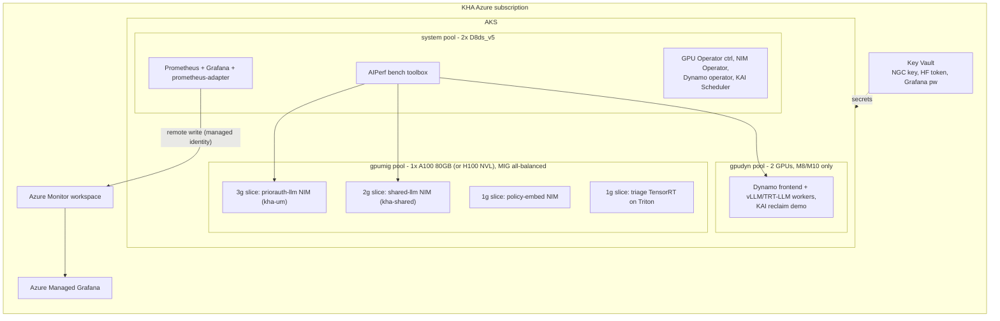

# Architecture and decisions

| Layer | NVIDIA | Azure | Open source |
|---|---|---|---|
| Infrastructure | - | AKS, NC A100 v4 / NC H100 v5 VMs, Spot, Azure Files, Premium SSD | Bicep |
| GPU lifecycle | GPU Operator (driver, toolkit, device plugin, GFD, MIG Manager, DCGM exporter, validator) | `--gpu-driver none` node pools | Node Feature Discovery |
| Scheduling | KAI Scheduler (queues, reclaim) | Cluster autoscaler | Kubernetes quotas |
| Serving | NIM Operator, NIM LLM 2.x, embedding NIM, Triton, TensorRT, Dynamo, TensorRT-LLM | - | vLLM (inside NIM and Dynamo) |
| Observability | DCGM | Azure Monitor workspace, Managed Grafana | Prometheus, Grafana, prometheus-adapter |
| Benchmarking | AIPerf, perf_analyzer, trtexec | - | - |

## ADR-01 GPU sharing: MIG for SLO tenants
**Context.** Three tenants plus two small models; the time-slicing incident. **Decision.** MIG `all-balanced`:
3g for prior-auth, 2g for the shared LLM, 1g + 1g for embeddings and triage. **Alternatives.** Time-slicing (no memory
or fault isolation, context-switch interference), MPS (memory limits and compute share, but shared fault domain),
one GPU per tenant (the 4-GPU status quo). **Consequences.** Hardware-isolated SMs, L2, and memory bandwidth per
slice; fixed geometry; each slice re-reads its own copy of the weights, so aggregate throughput is lower than one big
batch on the full GPU. M8 measures the trade.

## ADR-02 Driver ownership: GPU Operator-managed in the lab
**Decision.** GPU pools use `--gpu-driver none`; the GPU Operator installs driver and toolkit. **Why.** Runtime MIG
reconfiguration, DCGM profiling metrics, and driver pinning are the skills being practiced. **Production note.**
AKS-managed drivers with the GPU Operator's driver and toolkit disabled is a valid, Microsoft-supported default - but
never mix the two modes on one pool. (NVIDIA's AKS page still shows the retired `--skip-gpu-driver-install` flag.)

## ADR-03 Serving: NIM for tenants, Dynamo for scale-out
**Decision.** NIM Operator + NIM LLM 2.x (vLLM-based, NVIDIA-supported, OpenAI-compatible) for tenant endpoints.
Dynamo for multi-worker serving with KV-aware routing; TensorRT-LLM through Dynamo where peak throughput matters
(M10-D provides the evidence). **Rejected.** Hand-built vLLM containers: that is the lifecycle problem KHA has today.

## ADR-04 Observability: two tiers
In-cluster Prometheus drives fast control loops (HPA via prometheus-adapter, alerts) and deep dives. Remote write to
the Azure Monitor workspace gives retention, RBAC, and executive dashboards in Azure Managed Grafana, filtered to
`kha:*`, vLLM, and DCGM series to control ingestion cost.

## ADR-05 Routing and disaggregation on NC-series
NC A100 v4 / NC H100 v5 have no InfiniBand, so NIXL KV transfer falls back to a slow path. **Decision.** KV-aware
routing with aggregated workers now; revisit disaggregated prefill/decode on ND-series with InfiniBand when prompts
grow and ITL SLOs tighten. M10-C measures the penalty so the recommendation is evidence-based.

## ADR-06 Model storage
Lab: Azure Files Premium (RWX, billed on provisioned size, 100 GiB minimum) for the two LLM NIM caches and the Dynamo model snapshot; Azure Files Standard for the small embedding and triage models. Production: measure cold start
(M9) and move to Azure Managed Lustre, Premium SSD v2, or local NVMe with pre-warmed NIMCache if load time dominates.

## ADR-07 Capacity and cost
Spot for the lab and for claims batch; Regular + reservations or savings plans for SLO tenants. Open enrollment gets
scheduled pre-scaling, because GPU node cold start (minutes) is longer than a traffic spike's ramp.

## ADR-08 Tenancy and chargeback
Namespace per business unit, ResourceQuota on MIG resources (`requests.nvidia.com/mig-3g.40gb`), KAI queues with
guaranteed quota and over-quota borrowing when GPU pools are shared across teams. Cost allocation by slice share.

## ADR-09 Secrets
Key Vault is the source of truth. The lab projects secrets into namespaces with a script; production uses the Secrets
Store CSI driver with Workload Identity so no secret material is copied.
