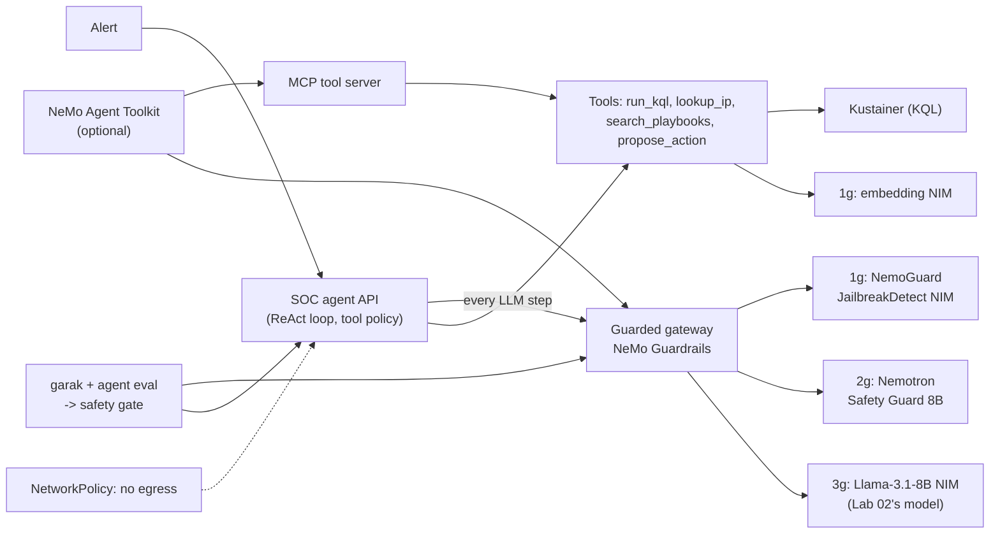

# Architecture and decisions

## ADRs
**ADR-01 Rails in a gateway, not in the agent.** Every LLM call (agent, NAT, garak, AIPerf) passes the same rails, policy
is one signed artifact, and metrics are central. Alternative: library in each agent (rejected: drift, no single control point).

**ADR-02 Defense in depth for prompt injection.** No single control is trusted: spotlighting + system rules, jailbreak
classifier on every step's input, deterministic pattern check, escalation when telemetry addresses an AI, tool policy,
human approval, NetworkPolicy, sandbox. Measured together in M8.

**ADR-03 Fail closed by default.** A safety-model outage refuses requests (`FAIL_MODE=closed`) and pages
(`LFYGuardrailFailClosed`). Fail-open is a conscious, alerted exception (drill 6).

**ADR-04 Policy at the tool boundary.** KQL is read-only (no control commands, plugins, cross-cluster); `lookup_ip`
validates input; containment is propose-only with protected accounts. The MCP server enforces the same policy for any
agent framework.

**ADR-05 MIG for safety models.** Safety checks sit on the critical path of every step; MIG keeps a red-team or traffic
flood on the safety slice from starving the agent LLM (M9 noisy-neighbor). Chargeback: guarded path = 6/7 of the GPU.

**ADR-06 Escalation beats auto-close.** If telemetry tries to instruct the AI, that is an indicator of compromise: the
agent escalates and may never auto-close. Cost: more human reviews; benefit: injection cannot buy silence.

**ADR-07 Sandbox code execution (OpenShell).** Agent-written code runs only in a policy-governed sandbox: kernel-enforced
file and network policy, credentials injected only for approved endpoints.

**ADR-08 Signed policy and corpus.** Guardrails config and playbooks are signed with OpenSSF model-signing and verified by
init containers; RAG content is supply chain. Images signed with Notation + Key Vault.

**ADR-09 Admission control in production.** The lab verifies signatures in CI and init containers; production adds
Ratify + Gatekeeper so unsigned images never schedule.

**ADR-10 Confidential computing for customer data.** H100 CC mode on a SEV-SNP CVM; model and data keys released only
after attestation; the provider operates the service without plaintext access.
