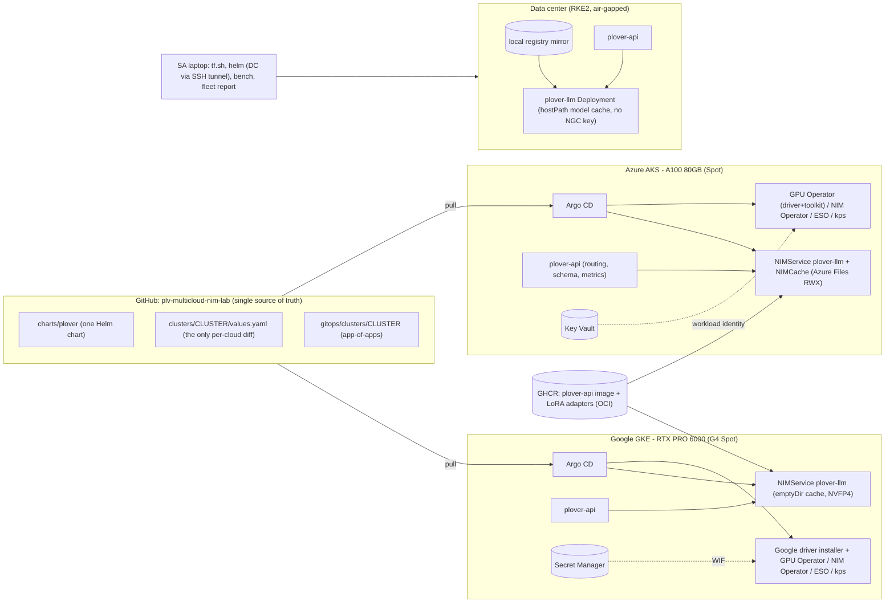

# Architecture and decisions

## ADRs (decision · alternatives · why · consequence)
1. **One Helm chart + per-cluster values over per-cloud manifests.** Alt: Kustomize overlays per cloud, cloud-native
   deploy tools. Why: the diff between `clusters/aks` and `clusters/gke` *is* the porting cost and fits on one screen.
   Consequence: chart tests render every cluster in CI (`tests/chart`).
2. **Pull-based GitOps (Argo CD per cluster) over CI push.** Alt: GitHub Actions `helm upgrade` with cloud credentials.
   Why: no cluster credentials in CI; drift self-heals; releases = commits (canary, rollback). Consequence: manual fixes
   need an explicit sync pause (M6, M12) - that friction is the feature.
3. **Cloud secret managers via External Secrets + workload identity.** Alt: sealed secrets, SOPS. Why: customers already
   govern Key Vault / Secret Manager; no secret in Git or Terraform state. Consequence: per-cloud identity plumbing
   (Azure federated credential, GKE WIF principal, EKS Pod Identity, OCI workload identity).
4. **LoRA adapters as OCI artifacts pulled by init containers into `/scratch/loras`.** Alt: NIMCache PVCs, object storage
   FUSE mounts. Why: same mechanism on every cloud and in the DC registry; digest-pinned; small. Consequence: adapter
   changes restart NIM pods (static mode) - acceptable for a release cadence of days.
5. **Model cache per platform:** AKS NIMCache on Azure Files Premium RWX (fast restarts, ~$16/month for 100 GiB);
   GKE emptyDir (cheaper, slower cold start - Filestore minimums cost more than the GPU for a PoC); DC hostPath pre-filled
   by `download-to-cache`. Consequence: cold-start times differ by cloud - measured in M7, explained to the customer.
6. **GPU per cloud from the selector, verified list checked per model.** AKS A100 80GB PCIe is cost-effective and in quota
   but **not** on NIM 2.0.13's verified list for Llama 3.1 8B (A100 SXM4 is) - accepted PoC risk; production on a
   verified SKU (NC H100 v5 H100 NVL, NCv6 RTX PRO 6000, ND A100 v4 SXM4). GKE G4 RTX PRO 6000 is verified and adds NVFP4.
7. **Driver ownership follows the platform:** AKS GPU Operator owns driver+toolkit (`gpu_driver = None`); GKE uses Google's
   driver installer + operator for the rest; EKS/OKE use GPU-enabled node images; the DC host owns an LTSB driver.
8. **RKE2 + registries.yaml mirror for the air gap.** Alt: image tarballs, k3s. Why: manifests keep original image names;
   the mirror is how customers' Harbor/Artifactory work. Consequence: the image list is a contract (`list-images.py`).
9. **MIG for train + serve on one GPU (lab only).** Prod: separate GPU pools for training and serving.
10. **Managed endpoints for prototyping and as a benchmark, not for PHI.** build.nvidia.com is trial/prototyping terms;
    managed compute (Foundry, Vertex, SageMaker) is evaluated in M10 with the same suites.
