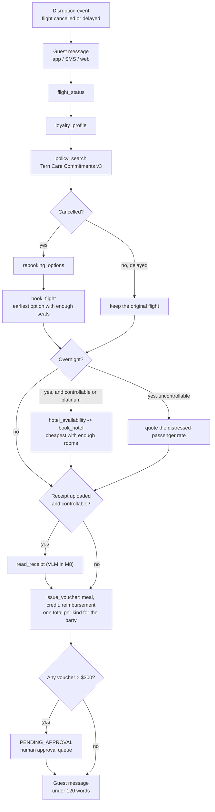

# M1 - Customer brief: Tern Travel Group (fictional)

**Tern Travel Group wants an AI agent that clears a winter-storm backlog of 40,000 disrupted travelers in hours, not
days, without giving away money its policy does not owe.** Everything here is synthetic: the company, people,
policy, amounts and data.

## Who they are
| Fact | Value |
|---|---|
| Hotels | 140 Tern Hotels in 9 countries |
| Airline | Tern Air, a regional airline: 60 aircraft, ~420 flights per day |
| Rail | one rail partner for connections |
| Loyalty program | four tiers: basic, silver, gold, platinum |
| Cloud | one hyperscaler today, open to a second; an EU region for EU guests |

## The problem: irregular operations (IROPS)
| Metric | Normal day | Winter-storm day |
|---|---|---|
| Disrupted travelers | ~2,500 | ~40,000 inside 6 hours |
| Average handle time (human agent) | 11 minutes | 11 minutes |
| Agent-hours needed | ~460 | ~7,330 |
| Queue time for a guest | minutes | ~3 hours |

The storm-day math: 40,000 travelers x 11 minutes = 440,000 agent-minutes. Clearing that in 6 hours would need about
1,220 agents working at once. Tern has nowhere near that, so guests wait 3 hours and the contact center pays overtime.

## What they asked for: the Disruption Concierge
For each disrupted traveler the agent must:
1. check the flight (status, cause, delay, overnight) and the traveler (loyalty tier, EU residency);
2. apply the **Tern Care Commitments v3** policy exactly ([data/policies/tern-care-v3.md](../data/policies/tern-care-v3.md));
3. rebook a cancelled flight, book a hotel when one is owed, issue meal, credit and reimbursement vouchers;
4. read an uploaded receipt image for reimbursement (M8);
5. write a short guest message, and send any voucher above $300 to a human for approval.

## What the golden set looks like
`python -m ttg.world --n 200 --seed 7 --stats` prints the 200-scenario golden set the PoC is judged on:

| Property | Count (of 200) |
|---|---|
| Cancelled / delayed | 106 / 94 |
| Controllable cause (crew, mechanical) | 100 |
| Overnight | 35 |
| Hotel bookings owed | 23 |
| Receipts uploaded | 66 |
| Need human approval (a voucher > $300) | 26 |
| Tiers: basic / silver / gold / platinum | 88 / 57 / 37 / 18 |
| Tool calls per task | 3 to 11 |

## The traffic shape (why this is an inference problem)
Replaying the policy oracle's trajectories through the real prompt builder gives these estimates (characters / 4;
replace with your measured numbers from M4):

| Per task | Estimate |
|---|---|
| LLM calls | 6.5 on average (4 to 12) |
| Prompt tokens, all calls | ~15,100 (p95 ~25,000) |
| Prompt tokens per call | ~2,400 median, ~3,100 max |
| Shared system prompt | ~1,840 tokens, byte-identical for every task |
| Uncached prompt tokens with an ideal prefix cache | ~620 (a ~96% hit ratio) |
| Output tokens (brief thoughts) | ~240 |

At a storm-day peak of about 3.7 tasks per second (2x the 6-hour average of 1.85), that is ~24 LLM calls, ~56,000
prompt tokens and ~900 output tokens per second. With a working prefix cache, only ~2,300 of those prompt tokens per
second are new. That one fact decides the engine choice in M4.

## Stakeholders
| Person (fictional) | Role | What they need to see |
|---|---|---|
| Rosa Delgado, VP Guest Operations | Sponsor | storm-day backlog cleared, guest satisfaction, handle time |
| Ken Ito, CIO | Platform owner | where it runs, who operates it, how it fails over |
| Amina Yusuf, Head of Contact Center | Champion | agents trust it; clean approval queue; escalation path |
| Lars Berg, CISO and DPO | Veto | GDPR residency, PCI scope, audit trail of every action |
| Grace Owusu, CFO | Approver | $ per 1,000 disruptions vs overtime and vouchers given away |
| Ops Control (Tern Air) | Data owner | flight status feed, rebooking inventory |
| Loyalty team | Policy owner | tier rules applied exactly, no over-compensation |

## Current state
- Agents rebook by hand in a legacy reservation screen and read a 12-page policy PDF.
- Vouchers are issued manually, and over-compensation is common on storm days.
- The website chatbot answers FAQs only. It cannot act.
- Nothing with guest data may go to a hosted API outside Tern's cloud tenant.

## Constraints
- **GDPR:** EU-resident guests are served by a deployment in the EU region. Their data never leaves it.
- **PCI:** card numbers never reach the LLM, prompts or traces. Refunds use payment tokens on file.
- **Money:** any single voucher above $300 needs a human approval (`PENDING_APPROVAL`).
- **Audit:** every tool call, argument and result is traced (`TTG_TRACE_DIR`).
- **PoC data:** synthetic only, from `ttg.world` (deterministic, seeded).

## Success criteria (PoC)
| # | Criterion | Target | Measured by |
|---|---|---|---|
| 1 | Policy-compliant task success on the golden set | >= 95% | `python -m ttg.bench.agent_bench` (`success_rate`, scored by `ttg.world.score`) |
| 2 | p95 end-to-end task latency at the storm-day operating point | <= 12 s | `agent_bench` levels + `python -m ttg.bench.ledger --slo-p95-s 12` |
| 3 | GPU cost per 1,000 disruptions | <= $2.00 | ledger `usd_per_1k_tasks` |
| 4 | Storm-day capacity plan | GPUs with N+1 | ledger + [docs/09](09-results-and-exec-readout.md) |

The full charter, with every criterion mapped to a tool, is in [sales/poc-charter.md](../sales/poc-charter.md).

## Discovery questions to ask first
1. How many travelers were disrupted on your worst storm day last winter, and over how many hours?
2. What share of storm-day contacts are rebookings, hotels, vouchers, or "where is my bag"?
3. Who owns the compensation policy, and how often does it change?
4. What does over-compensation cost you per storm today?
5. Which systems of record must the agent call, and do they have APIs?
6. Which guests are EU residents, and where must their data be processed?
7. What latency do guests tolerate in the app before they call instead?
8. Who approves large vouchers today, and how fast?

The full list, by stakeholder, is in [sales/discovery-questions.md](../sales/discovery-questions.md).

**Checkpoint:** you can explain the storm-day math (40,000 x 11 minutes), the agent's traffic shape (6.5 calls, ~96%
shared prompt), and the four success criteria, each with the tool that measures it.

**Say it:** "On your worst storm day you need about 7,300 agent-hours in 6 hours. We will prove an agent can do the
policy work for 95% of travelers within 12 seconds each, and we will show you the GPU cost per thousand disruptions,
measured, not quoted."
