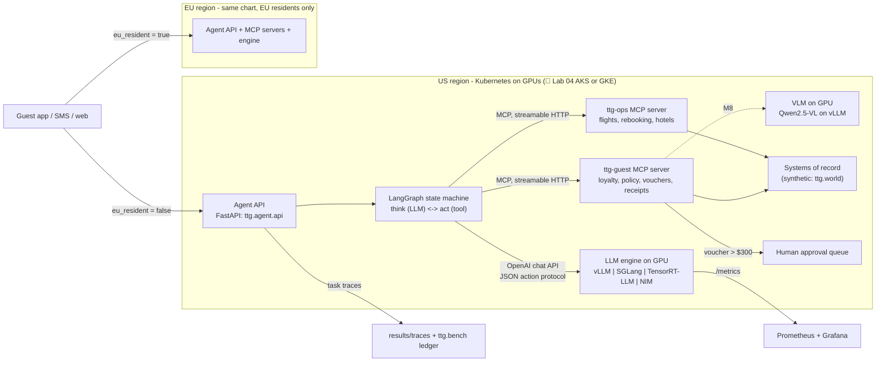
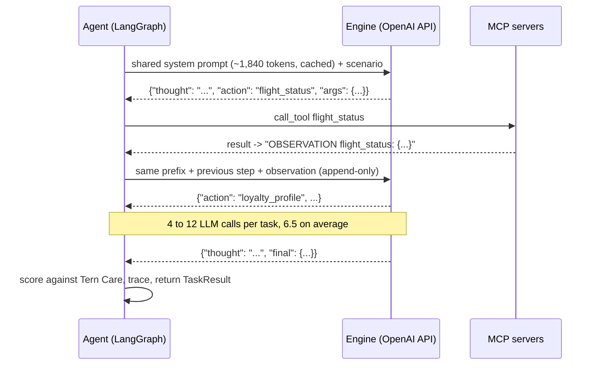

# M3 - Architecture and decisions

**One agent API drives one LLM engine and two MCP tool servers; every engine sees byte-identical prompts, so the
bake-off in M4 measures the engine and nothing else.** EU guests get their own copy of the stack in the EU region.

## The picture

## One task, step by step

## Components
| Component | Path | Module |
|---|---|---|
| Synthetic world, policy oracle, scoring | `ttg/world.py` | M3 |
| MCP servers (ttg-ops, ttg-guest) | `ttg/mcp/ops_server.py`, `ttg/mcp/guest_server.py` | M3 |
| Cache-stable prompts | `ttg/agent/prompts.py` | M3, M5 |
| JSON action protocol | `ttg/agent/protocol.py` | M3 |
| LangGraph state machine | `ttg/agent/graph.py` | M3 |
| LLM client: TTFT, usage, cached tokens | `ttg/agent/llm.py` | M4 |
| Agent API | `ttg/agent/api.py` | M9 |
| Mock engine for laptops and CI | `ttg/mock/fake_llm.py` | M0, M9 |
| Benchmarks and the acceleration ledger | `ttg/bench/agent_bench.py`, `ttg/bench/ledger.py` | M4, M10 |
| Engine launchers | `engines/launch.sh` | M4-M8 |
| Helm chart and GitLab pipeline | `deploy/helm/ttg`, `.gitlab-ci.yml` | M9 |

## Decisions (ADRs)

### ADR-01 - A JSON action protocol instead of native tool calling
**Context.** Tool-call parsing differs per engine and per model: vLLM `--tool-call-parser llama3_json`, SGLang
`--tool-call-parser llama3`, trtllm-serve `--tool_parser`, NIM's built-in parser. A fair bake-off needs identical
prompts and identical output expectations.
**Decision.** The model returns one JSON object per turn: an action or a final answer. The agent parses and validates
it against the MCP tool schemas (`ttg/agent/protocol.py`). Invalid output gets a fix-it message and a bounded retry.
**Consequences.** Works on any OpenAI-compatible endpoint. Retries become a metric (`retries_per_task`).
`TTG_STRUCTURED=json_schema` adds constrained decoding when the engine supports it. We give up engine-specific
features such as parallel tool calls.
**Revisit when** every engine you ship parses tool calls the same way for your model (M4 stretch).

### ADR-02 - Cache-stable prompts
**Context.** An agent re-sends its whole context on every step. The system prompt (role, protocol, tool catalog,
policy digest, one worked example) is 7,360 characters, about 1,840 tokens, on every call.
**Decision.** The system prompt is byte-identical for every task and every run. History is append-only. Observations
are serialized with sorted keys. Nothing dynamic (time, request id, shuffled tools) goes before the history.
**Consequences.** With a working prefix cache, an estimated ~96% of prompt tokens are reused (oracle trajectories,
characters / 4). Drill 1 (`TTG_BUST_CACHE=1`) shows the bill when someone adds a timestamp.
**Revisit when** you personalize the system prompt: put personal data after the shared prefix, never before it.

### ADR-03 - MCP servers instead of in-process function calls
**Context.** Tern's systems of record have different owners: Ops Control, Loyalty, Finance.
**Decision.** Nine tools in two FastMCP servers: `ttg-ops` (flights, rebooking, hotels) and `ttg-guest` (loyalty,
policy, vouchers, receipts). stdio on a laptop; streamable HTTP in Kubernetes (ports 8101 and 8102).
**Consequences.** The same tools serve any agent framework: LangGraph today, the NeMo Agent Toolkit or the
customer's own framework tomorrow. Each owner runs their server, and NetworkPolicy draws the boundary. The cost is a
few milliseconds per call, visible in `tool_time_s`.
**Revisit when** a tool needs streaming or long-running jobs: MCP supports progress notifications.

### ADR-04 - An explicit LangGraph state machine, not the prebuilt ReAct agent
**Context.** We need per-step timing, a retry edge for invalid JSON, a step budget and a clean final node.
**Decision.** A custom `StateGraph` with two nodes (`ttg/agent/graph.py`): `think` makes one LLM call and parses the
JSON (an invalid reply loops back with a fix-it message), and `act` makes one MCP tool call. Conditional edges end
the task on a final answer, an error or the step budget (`TTG_MAX_STEPS=14`).
**Consequences.** Every LLM call records TTFT, tokens and cached tokens; every tool call records its latency. The
prebuilt ReAct agent assumes native tool calling (ADR-01) and hides those numbers.
**Revisit when** you need human-in-the-loop interrupts inside the graph: LangGraph supports them.

### ADR-05 - Fine-tuning data from the policy oracle
**Context.** M6 needs thousands of correct agent trajectories.
**Decision.** `ttg.world.expected_plan` generates exact trajectories for free. A teacher model on build.nvidia.com is
optional, and its trajectories are kept only when they match the oracle (rejection sampling).
**Consequences.** Perfect labels for a synthetic policy, offline, at zero cost. A real deployment needs
human-reviewed trajectories or a teacher plus a verifier.
**Revisit when** the policy changes: regenerate the data, retrain, and let the release gate decide.

### ADR-06 - Llama 3.1 8B (+ LoRA) before a 70B
**Context.** The policy is narrow and fully checkable. Every extra GPU multiplies storm-day cost.
**Decision.** Start with Llama 3.1 8B: 16 GB in BF16, one GPU, a ~4.8 ms per token decode floor on an H100 SXM.
A 70B needs 2x H100 even in FP8 (~10.5 ms per token floor) for roughly twice the latency and twice the GPUs.
**Consequences.** If the 8B passes the golden set at 95% or more, the 70B is pure cost. M6's LoRA can bake the
policy into the weights and shorten the prompt.
**Revisit when** the 8B misses 95% on the golden set after prompt and LoRA work.

### ADR-07 - FP8 weights on Hopper and Ada, behind an eval gate
**Context.** Decode is bandwidth-bound: halving weight bytes lowers the latency floor and frees memory for KV cache.
**Decision.** FP8 is a candidate, not a default. vLLM and SGLang quantize online (`--quantization fp8`);
TensorRT-LLM uses the pre-quantized `nvidia/Llama-3.1-8B-Instruct-FP8` checkpoint. NVFP4 is the Blackwell path (🔁 Lab 04).
**Consequences.** Ship FP8 only if task success on the golden set stays within the gate.
**Revisit when** you move to Blackwell GPUs.

### ADR-08 - N-gram speculative decoding for tool steps, chosen per operating point
**Context.** Tool calls copy flight numbers, ids and amounts straight from the context, so prompt-lookup drafts are
often accepted.
**Decision.** Measure `spec` vs `base` in M5 at the storm-day operating point. Turn it on only where it wins.
**Consequences.** At low concurrency speculation cuts inter-token latency. At high concurrency the GPU is
compute-bound, and verifying drafts costs throughput (drill 4).
**Revisit when** the operating point or the GPU changes.

### ADR-09 - GitLab CI with an eval gate and a perf gate
**Context.** Prompts, models, engines and policy all change. Any of them can break success or cost.
**Decision.** lint -> test -> eval gate (mock engine, success >= 0.95) -> perf gate (GPU runner, p95 and $ per 1,000
tasks within 10% of the baseline) -> build -> deploy (manual). 🔁 Lab 04's perf gate, on agent tasks.
**Consequences.** A cache-busting prompt change fails the perf gate before it reaches a storm day. Baselines are
re-recorded deliberately, never automatically.
**Revisit when** the team adds a canary stage in production.

### ADR-10 - A mock OpenAI-compatible engine for laptops and CI
**Context.** GPUs cost money and are not in CI runners.
**Decision.** `ttg/mock/fake_llm.py` answers from the policy oracle, emulates prefix caching, TTFT and inter-token
latency, and injects faults on demand (`MOCK_FAULTS`).
**Consequences.** The agent, MCP servers, benchmarks, ledger and Helm chart all run with no GPU. Numbers from the mock
teach the shape of the curves; they are never quoted to a customer.
**Revisit when** the mock's behavior drifts from the engines: compare its curves with M4's every quarter.

### ADR-11 - Data residency and PCI by deployment, not by prompt
**Context.** GDPR requires EU residents' data to stay in the EU. PCI forbids card numbers in LLM context.
**Decision.** EU residents are routed to an EU deployment of the same chart. No tool returns or accepts card
numbers; refunds use payment tokens. Traces never hold payment data.
**Consequences.** Two deployments to operate (one chart, two values files). An instruction in a prompt is never the
control. 🔁 The PHI-sovereignty pattern from Labs 02-04.
**Revisit when** a third region appears: it is a values file, not a redesign.

**Checkpoint:** draw the picture from memory, then explain ADR-01 and ADR-02 to a platform engineer in two minutes each.

**Say it:** "We kept the agent engine-agnostic on purpose: one prompt protocol, one shared prefix and standard MCP
tools, so when we compare vLLM, SGLang, TensorRT-LLM and NIM on your traffic, the only thing that changes is the engine."
