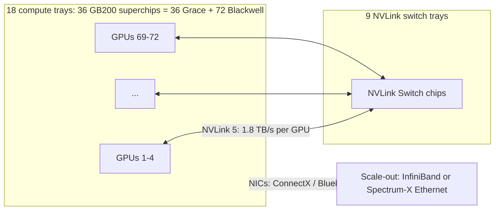

# 04 - GPU cluster architecture: from one GPU to an NVL72 rack (M7, paper part)

**Goal:** draw the hierarchy from HBM to the scale-out network with the bandwidth at every level, describe GB200 NVL72
in 60 seconds, and read a node's topology with `nvidia-smi` and NCCL. 🔁 Lab 02 (MIG, Dynamo), recall Q12-13.

**Time:** 30 min reading + 15 min whiteboard, on a laptop. The measurements are in
[docs/05](05-parallelism-math.md) section 6 (one 8x H100 SXM node, ~2 h).
**JD line:** "GPU cluster architecture and parallelism."

## 1. The bandwidth ladder (memorize the ratios)
| Level | What it connects | Per GPU, one direction | Latency class |
|---|---|---|---|
| HBM3 on H100 SXM | a GPU and its own 80 GB | 3,350 GB/s | ~ns |
| NVLink 4 + NVSwitch (DGX/HGX H100) | 8 GPUs, any to any | 450 GB/s (900 GB/s both ways, 18 links) | ~µs |
| NVLink 5 + NVLink Switch (GB200 NVL72) | 72 GPUs, any to any | 900 GB/s (1.8 TB/s both ways) | ~µs |
| PCIe Gen5 x16 | GPU to CPU or NIC (H100 nodes) | ~64 GB/s | µs, more hops |
| PCIe Gen4 x16 | GPU to GPU on L40S nodes (no NVLink), GPU to CPU | ~32 GB/s | µs, more hops |
| InfiniBand NDR or 400 GbE, one NIC per GPU | node to node | 50 GB/s | ~µs + switch hops |
| InfiniBand XDR / 800G SuperNIC, one per GPU | node to node | 100 GB/s | same |

Leaving the GPU costs ~7x (HBM 3,350 to NVLink 450 GB/s). Leaving the NVLink domain costs another ~9x (450 to one
50 GB/s NIC). Parallelism plans follow the ladder: the chattiest traffic (tensor-parallel all-reduces, MoE
all-to-all) stays on the fastest link. `python3 -m parallel.parallelism_calc --links`
prints the table the calculator uses, with the latency (alpha) it assumes per message.

## 2. The node you rent in M7: DGX H100 (HGX H100 boards are the same GPU baseboard)
| Part | DGX H100 (user guide, verified 2026-10-17) |
|---|---|
| GPUs | 8x H100 SXM, 640 GB HBM3 total |
| GPU fabric | NVSwitch, 4th-generation NVLink: 900 GB/s GPU-to-GPU (every GPU reaches every other at full rate) |
| CPUs, memory | 2x Intel Xeon 8480C (56 cores each), 2 TB DDR5 |
| Compute network | 4x OSFP ports for 8x ConnectX-7 single-port cards: InfiniBand up to 400 Gb/s, ONE NIC PER GPU |
| Storage + in-band network | 2x ConnectX-7 dual-port (Ethernet default) |
| Local storage | 2x 1.92 TB NVMe (OS, RAID 1) + 8x 3.84 TB NVMe data cache (RAID 0, ~30 TB) |
| Power | 6 PSUs (4+2), 10.2 kW max |

Why one NIC per GPU: each GPU sends its own share of every inter-node collective at 400 Gb/s, through GPUDirect
RDMA (the NIC reads and writes GPU memory directly, no CPU copy). The local NVMe cache is the M5 cold-start lever:
weights load from local disk instead of the network.

## 3. Read the topology yourself (5 min on any GPU VM)
```bash
nvidia-smi topo -m          # GPU-to-GPU and GPU-to-NIC paths, plus CPU and NUMA affinity
nvidia-smi nvlink -s        # every NVLink, its state and speed (errors if the node has no NVLink)
```
`nvidia-smi topo -m` legend: `NV#` = a bonded set of # NVLinks; `PIX` = at most one PCIe bridge; `PXB` = several
PCIe bridges; `PHB` = through a PCIe host bridge (the CPU); `NODE` = across host bridges in one NUMA node; `SYS` =
across the CPU-to-CPU link (UPI). What to expect:
- 8x H100 SXM: every GPU pair shows `NV18` (18 NVLinks, all through NVSwitch). `nvidia-smi nvlink -s` lists 18 links
  per GPU.
- 4x L40S PCIe: no `NV#` at all. GPU pairs show `NODE` or `SYS`, so peer traffic crosses PCIe and maybe the CPUs.
- The NIC rows tell you which GPU is "closest" to each NIC (`PIX`/`PXB`). NCCL uses exactly this to pick rails.

Then let NCCL tell you what it chose. `parallel/nccl_tests.sh` sets `NCCL_DEBUG=INFO` and keeps the log:
look for `via P2P` (NVLink or PCIe peer-to-peer), `via SHM` (through host memory), `NVLS` (NVLink SHARP) and
`NET/IB` (InfiniBand). The exact wording changes between NCCL versions; the transport names do not.

## 4. GB200 NVL72: the 60-second answer
**"Describe the structure of the NVL72 as best as you can."** (asked verbatim to an earlier candidate)

> "GB200 NVL72 is one liquid-cooled rack that NVIDIA describes as a 72-GPU NVLink domain acting as a single, massive
> GPU. The building block is the GB200 superchip: one Grace CPU and two Blackwell GPUs. The rack holds 36 of them:
> 36 Grace CPUs and 72 Blackwell GPUs, in 18 one-RU compute trays. Nine NVLink switch trays connect all 72 GPUs
> through four NVLink cable cartridges at the back of the rack: over 5,000 copper cables.
> Each GPU gets fifth-generation NVLink at 1.8 TB/s to any other GPU, about 130 TB/s for the rack.
> Memory is 13.4 TB of HBM3E at 576 TB/s, plus 17 TB of LPDDR5X on the Grace side.
> Why it matters: a DGX H100 has 8 GPUs in its NVLink domain; NVL72 has 72 at twice the per-GPU bandwidth. Tensor and
> expert parallelism for a big MoE stay on NVLink instead of crossing InfiniBand - in my calculator an expert-parallel
> all-to-all for DeepSeek-V3 drops from ~34 ms over InfiniBand NDR to ~3 ms inside one NVL72. Racks then scale out
> over InfiniBand or Spectrum-X Ethernet."

Say it in this order: building block, counts, interconnect, memory, why it matters. Stop at 60 seconds.

| GB200 NVL72 | Value | Per GPU |
|---|---|---|
| CPUs, GPUs | 36 Grace, 72 Blackwell (36 GB200 superchips) | - |
| NVLink | 130 TB/s all-to-all; 260 TB/s all-reduce (OCP blog figure, in-switch reduction) | 1.8 TB/s both ways |
| GPU memory | 13.4 TB HBM3E, 576 TB/s | ~186 GB, 8 TB/s |
| CPU memory | 17 TB LPDDR5X, 14 TB/s; 2,592 Arm Neoverse V2 cores | - |
| Tensor cores (dense) | NVFP4 720 PFLOPS; FP8 360; BF16 180 (page lists sparse; dense is half) | FP8 5 PFLOPS |
| Rack | 18 compute trays + 9 switch trays (1RU, liquid-cooled) + 4 NVLink cartridges; MGX-derived; 120 kW cooling capacity | - |

The per-GPU column is arithmetic (rack value / 72), the same numbers `archmath` uses for its `B200-in-GB200` row.
GB300 NVL72 applies the same 72-GPU, liquid-cooled rack-scale design to Blackwell Ultra GPUs.



## 5. Scale-out: how nodes and racks talk
**Rail-optimized fabric.** In a DGX SuperPOD, the NIC next to GPU i in every node cables to the same leaf switches:
"rail i". NVIDIA's H100 reference architecture: "Each group of 32 nodes is rail-aligned", so traffic on a rail is
"always one hop away from the other 31 nodes" in that scalable unit; cross-rail traffic goes through the spine.
NCCL keeps traffic on rails: if data sits on the wrong GPU, it first moves over NVLink to the GPU on the right rail
(PXN), then crosses the network.

**InfiniBand or Ethernet.**
| | InfiniBand (Quantum-2 NDR 400G, Quantum-X800 XDR 800G) | Spectrum-X Ethernet (Spectrum-4 switches + BlueField-3 SuperNICs) |
|---|---|---|
| Why customers pick it | lowest latency, credit-based lossless fabric, in-network reduction (SHARP), the AI-training default | Ethernet operations and tooling; RoCE with adaptive routing and congestion control tuned for AI |
| What to ask | existing IB skills? one big training cluster? | multi-tenant cloud? existing Ethernet team and automation? |

**In-network reduction: two different "SHARP"s.**
- SHARP on Quantum InfiniBand switches: the switch adds up the gradients, so each GPU sends its data once instead of
  ~2x around a ring. NCCL uses it through the CollNet path (`NCCL_COLLNET_ENABLE=1` + the SHARP plugin).
- NVLink SHARP (NVLS) on the NVSwitch inside an H100 or NVL72 system: the same idea inside the NVLink domain. NCCL picks
  the `NVLS` algorithm by default where available. `parallel/nccl_tests.sh 8 --nvls-off` measures what it buys you.

## 6. Collectives in one table
| Collective | Bytes each GPU sends (ring, n GPUs, message M) | Who uses it |
|---|---|---|
| all-reduce | 2(n-1)/n x M (reduce-scatter + all-gather) | DP gradients; TP: 2 per layer forward, 2 backward |
| all-gather / reduce-scatter | (n-1)/n x M | FSDP / ZeRO-3 weights and gradients; sequence parallel |
| all-to-all | (n-1)/n x M | MoE expert parallelism: dispatch tokens, combine results |
| send / receive | M | pipeline parallel activations between stages |
| broadcast | M | weights at start, rarely on the hot path |

- **Ring:** bandwidth-optimal (each GPU sends 2(n-1)/n x M), but latency grows with n. Best for big messages in a node.
- **Tree:** latency grows with log n. NCCL uses double binary trees across many nodes for small and medium messages.
- **NVLS / SHARP:** the switch does the arithmetic; GPUs send about half the bytes of a ring.
- **Bus bandwidth** (what nccl-tests prints): algorithm bandwidth x 2(n-1)/n for all-reduce. It is comparable to the
  per-direction link rate for any n. `python3 -m parallel.compare_nccl` turns a log into "EFFICIENCY" and "alpha" for
  the calculator.

## 7. NCCL environment variables you will actually use
| Variable | What it does | When |
|---|---|---|
| `NCCL_DEBUG=INFO` | prints topology, rings/trees and the transport per channel | always, first |
| `NCCL_DEBUG_SUBSYS=INIT,GRAPH` | limits INFO to init and topology search | long logs |
| `NCCL_TOPO_DUMP_FILE=/tmp/topo.xml` | writes the topology NCCL detected | "why is it slow" tickets |
| `NCCL_P2P_DISABLE=1` | no GPU peer-to-peer: traffic goes through host memory | drill 5 only (`nccl_tests.sh --p2p-off`) |
| `NCCL_NVLS_ENABLE=0` | turns off NVLink SHARP | A/B test (`nccl_tests.sh --nvls-off`) |
| `NCCL_IB_HCA=mlx5_0,mlx5_1` | which RDMA NICs to use (`^=mlx5_4` excludes one) | storage NIC picked by mistake |
| `NCCL_SOCKET_IFNAME=eth0` | interface for bootstrap and socket transport | multi-NIC hosts, containers |
| `NCCL_IB_GID_INDEX` | RoCE GID selection (AUTO by default in recent NCCL) | Ethernet fabrics |
| `NCCL_ALGO`, `NCCL_PROTO` | force Ring / Tree / NVLS, or LL / LL128 / Simple | debugging only, never production |

## 8. Where each kind of parallelism lives on the ladder
| Parallelism | Traffic pattern | Put it on | Why |
|---|---|---|---|
| Tensor (TP) | 2 all-reduces per layer per forward, small and frequent | inside one NVLink domain (8 GPUs, or up to 72 on NVL72) | latency-bound at decode; PCIe or IB makes every token pay |
| Expert (EP) | 2 all-to-alls per MoE layer | inside NVLink; NVL72 is built for it | all-to-all is the hardest pattern for a network |
| Context (CP) | ring of KV blocks, overlappable | NVLink or one rail | long-context prefill |
| Pipeline (PP) | point-to-point activations between stages | across nodes | small messages, tolerant of IB |
| Data (DP / FSDP) | one gradient all-reduce per step (FSDP: per layer), overlappable | everywhere, outermost | hides behind backward compute |
| Replicas (serving) | none between replicas | anywhere: a load balancer | throughput scales linearly |

Two serving patterns from Lab 02 come back here: MIG slices one H100 into up to 7 isolated GPUs for small models,
and Dynamo splits prefill and decode onto different GPUs and moves the KV cache between them over NVLink or RDMA.
NVL72 makes that KV transfer an NVLink copy.

## Checkpoint
- [ ] You can draw the bandwidth ladder with numbers: 3.35 TB/s, 450 GB/s, 900 GB/s, ~64 GB/s, 50 GB/s.
- [ ] You can give the NVL72 answer in 60 seconds, in the order above, without notes.
- [ ] You can read `nvidia-smi topo -m` and say whether two GPUs talk over NVLink, one PCIe switch or the CPUs.
- [ ] You can explain rail-optimized fabric, SHARP and NVLS in one sentence each.
- [ ] You know which NCCL variable you set first (`NCCL_DEBUG=INFO`) and which ones are drills only.

## Say it
"Inside one NVLink domain you get ~450 GB/s per GPU per direction; across the network you get ~50. So we keep tensor
and expert parallelism inside NVLink - 8 GPUs on an H100 node, 72 on an NVL72 - and let data parallelism and
pipelines cross InfiniBand."

## Whiteboard drills (60 seconds each)
1. **"Two 8x H100 nodes. Where does TP 16 hurt?"** Every all-reduce now spans both nodes - 160 per token for a 70B.
   NCCL spreads each one over all 8 NICs, so big messages still see ~360 GB/s of bus bandwidth; but decode
   all-reduces are tiny, so each pays inter-node latency (more ring steps, switch hops, no NVLink SHARP across nodes)
   and competes with any other traffic on the NICs. Keep TP 8 inside the node; use PP 2 or DP 2 across nodes.
2. **"The customer's all-reduce bus bandwidth is 180 GB/s on 8x H100. Healthy?"** No: the ring algorithm reaches
   ~80% of 450 GB/s (~360), and NVLink SHARP (on by default with NVSwitch) can read 400+. Check `nvidia-smi topo -m`
   for NV18, `NCCL_DEBUG=INFO` for P2P/NVLS vs SHM, link state with `nvidia-smi nvlink -s` and error counters with
   `nvidia-smi nvlink -e`, and whether the VM really has NVSwitch (some instances expose PCIe only).
3. **"Why is NVL72 a big deal for MoE inference?"** Expert parallelism over 72 GPUs keeps the all-to-all on NVLink:
   ~3 ms instead of ~34 ms per decode step for DeepSeek-V3 in the M7 calculator (E5).
4. **"InfiniBand or Spectrum-X?"** Both work for AI. IB: lowest latency, SHARP, the training default. Spectrum-X: AI-tuned
   Ethernet for teams that run Ethernet. Decide on operations and scale, then verify with nccl-tests.

## Sources
- [NVIDIA GB200 NVL72](https://www.nvidia.com/en-us/data-center/gb200-nvl72/) - 36 Grace + 72 Blackwell, liquid-cooled,
  "a 72-GPU NVIDIA NVLink domain that acts as a single, massive GPU", 1.8 TB/s per GPU, 130 TB/s, 13.4 TB HBM3E at
  576 TB/s, 17 TB LPDDR5X at 14 TB/s, 2,592 Neoverse V2 cores, tensor-core table (sparse; dense is one-half).
- [NVIDIA contributes GB200 NVL72 designs to OCP](https://developer.nvidia.com/blog/nvidia-contributes-nvidia-gb200-nvl72-designs-to-open-compute-project)
  - 18 compute trays, nine switch trays, four NVLink cartridges with over 5,000 active copper cables, 1RU liquid-cooled
  trays, MGX-derived rack, 130 TB/s all-to-all, 260 TB/s all-reduce, 120 kW cooling capacity.
- [Introduction to NVIDIA DGX H100/H200 systems](https://docs.nvidia.com/dgx/dgxh100-user-guide/introduction-to-dgxh100.html)
  - GPUs, NVSwitch/NVLink 900 GB/s, CPUs, 8x ConnectX-7 single-port via 4 OSFP ports, storage, 10.2 kW.
- [DGX SuperPOD H100 reference architecture: network fabrics](https://docs.nvidia.com/dgx-superpod/reference-architecture-scalable-infrastructure-h100/latest/network-fabrics.html)
  - rail-aligned 32-node scalable units, one hop per rail, spine for cross-rail traffic.
- [NCCL environment variables](https://docs.nvidia.com/deeplearning/nccl/user-guide/docs/env.html) and
  [nccl-tests performance notes](https://github.com/NVIDIA/nccl-tests/blob/master/doc/PERFORMANCE.md) (algbw vs busbw).
- Not verified on a primary page (treat as "widely published"): the GB200 superchip's NVLink-C2C link between Grace
  and Blackwell, and the number of NVLink Switch chips per switch tray. Confirm before quoting.
