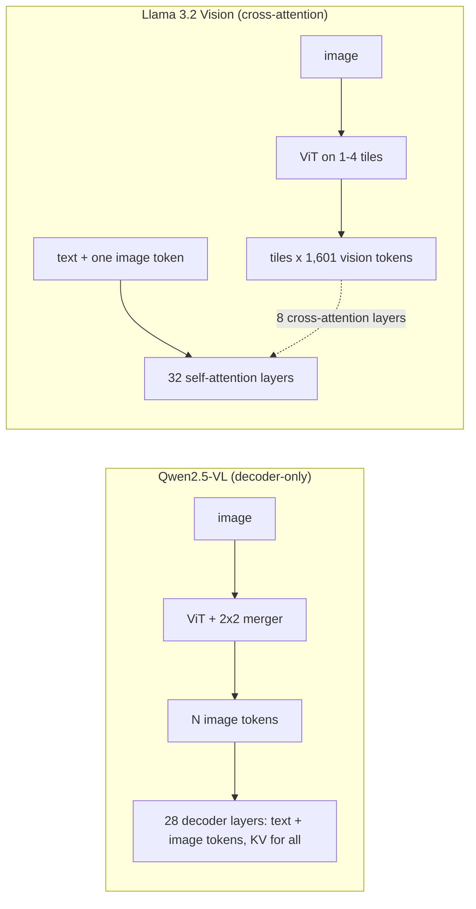

# 06 - Multimodal: the VLM reads the receipt (M8)

**Goal:** predict exactly how many tokens an image costs on two VLM architectures, serve Qwen2.5-VL on vLLM, score
receipt extraction against ground truth, sweep resolution against TTFT and accuracy, then wire the VLM into the agent
and measure what it changes in the money the agent pays.
🔁 Lab 01 sweeps, Lab 02 KV math, M2 architectures ([docs/03](03-model-complexity.md)), M5 prefix caching and TTFT.

**Time:** 2 h on 1x H100 80 GB (an L40S 48 GB works). Sections 1-3 run on a laptop.
**JD line:** "Multimodal LLMs and vision-language models."
**Tools:** `vlm/vlm_tokens.py` (token math), `vlm/make_receipts.py` (images + labels), `vlm/extract_receipt.py`
(`extract_fields`, scoring), `vlm/vlm_sweep.py` (resolution sweep), `vlm/agent_receipts.py` (agent with vs without VLM).

**Why Tern cares:** a third of the golden set's disrupted travelers upload a receipt (66 of 200 scenarios); 35 are
owed a reimbursement of min(receipt total, $50 x party). Today an agent types the total by hand. A misread total is
a wrong payment. The VLM replaces the oracle behind the same `read_receipt` MCP tool: the agent does not change.

## 0. Predict first (5 min, no tools)
1. A guest photographs a receipt with a 12 MP phone camera (3024 x 4032). How many tokens on Qwen2.5-VL?
2. The same photo on Llama 3.2 11B Vision: how many tokens enter the text sequence?
3. Which costs more KV cache for that photo, and by how much?

## 1. Two ways to put an image into an LLM
| | Decoder-only VLM: Qwen2.5-VL-7B | Cross-attention VLM: Llama 3.2 11B Vision |
|---|---|---|
| Vision encoder | ViT, 14 x 14 pixel patches, 2 x 2 patches merged into 1 token | ViT on 560 x 560 tiles, 40 x 40 patches + 1 class token per tile |
| Tokens per image | (H/28) x (W/28) after smart_resize: depends on resolution | tiles x 1,601 (1 to 4 tiles), but only ONE `<|image|>` token in the text |
| Where image tokens live | in the text sequence: every decoder layer attends to them, KV in all 28 layers | outside it: 8 cross-attention layers attend to them |
| KV per image token | 56 KiB (28 layers x 4 KV heads x 128 x 2 x 2 bytes) | 32 KiB (8 cross-attention layers only) |
| Prefill cost | encoder + full LLM prefill of every image token | encoder + 8 cross-attention layers |
| Resolution knob | `max_pixels` (vLLM `--mm-processor-kwargs`), or resize before sending | fixed: the canvas picks 1-4 tiles |



## 2. Count the tokens exactly (15 min, laptop)
```bash
python3 -m vlm.vlm_tokens --table                    # the shapes the Tern agent meets
python3 -m vlm.vlm_tokens --size 3024x4032 --size 1170x2532 --max-pixels 1003520   # with a pixel cap
```
Real output (2026-10-17):

Qwen2.5-VL-7B (max_pixels 12,845,056 = 16,384 tokens max; 180 text tokens of prompt; TTFT floor on H100 BF16 at 50% MFU):

| image | pixels (w x h) | smart_resize | image tokens | image KV MiB | ViT TFLOP | LLM prefill TFLOP | TTFT floor ms |
|---|---|---|---|---|---|---|---|
| Tern receipt render (vlm/make_receipts.py, 4 items) | 640 x 662 | 644 x 672 | 552 | 30.2 | 3.1 | 9.7 | 26 |
| Same receipt resized to 448 px long side | 433 x 448 | 420 x 448 | 240 | 13.1 | 1.3 | 5.5 | 14 |
| Phone photo of a receipt, 12 MP | 3024 x 4032 | 3024 x 4032 | 15,552 | 850.5 | 164.0 | 255.0 | 847 |
| Same photo resized to 1344 px long side | 1008 x 1344 | 1008 x 1344 | 1,728 | 94.5 | 10.4 | 25.7 | 73 |
| Boarding-pass screenshot (phone, 1170 x 2532) | 1170 x 2532 | 1176 x 2520 | 3,780 | 206.7 | 25.3 | 54.9 | 162 |
| 4K video frame (3840 x 2160) | 3840 x 2160 | 3836 x 2156 | 10,549 | 576.9 | 93.9 | 163.2 | 520 |

Llama 3.2 11B Vision (560 x 560 tiles, max 4, 1,601 vision tokens per tile, 8 cross-attention layers):

| image | canvas (w x h) | tiles | vision tokens | cross-attn KV MiB | tokens in the text sequence |
|---|---|---|---|---|---|
| Tern receipt render (vlm/make_receipts.py, 4 items) | 1120 x 1120 | 4 | 6,404 | 200.1 | 1 |
| Same receipt resized to 448 px long side | 560 x 560 | 1 | 1,601 | 50.0 | 1 |
| Phone photo of a receipt, 12 MP | 1120 x 1120 | 4 | 6,404 | 200.1 | 1 |
| Same photo resized to 1344 px long side | 1120 x 1120 | 4 | 6,404 | 200.1 | 1 |
| Boarding-pass screenshot (phone, 1170 x 2532) | 560 x 1680 | 3 | 4,803 | 150.1 | 1 |
| 4K video frame (3840 x 2160) | 1120 x 1120 | 4 | 6,404 | 200.1 | 1 |

With `--max-pixels 1003520` (the image-processor class default, 1,280 tokens max):

| image | pixels (w x h) | smart_resize | image tokens | image KV MiB | ViT TFLOP | LLM prefill TFLOP | TTFT floor ms |
|---|---|---|---|---|---|---|---|
| 3024 x 4032 | 3024 x 4032 | 840 x 1148 | 1,230 | 67.3 | 7.2 | 18.8 | 53 |
| 1170 x 2532 | 1170 x 2532 | 672 x 1456 | 1,248 | 68.2 | 7.3 | 19.1 | 53 |

How the numbers come out:
- **smart_resize** (Qwen): round each side to a multiple of 28; if the pixels exceed `max_pixels`, shrink both sides
  by the same factor and floor to 28. The checkpoint's `preprocessor_config.json` sets `max_pixels` = 12,845,056, so a
  12 MP photo passes through untouched: **15,552 tokens** (prediction 1), 850 MiB of KV, ~0.85 s of prefill.
- **Tile KV depends on the engine:** the Hugging Face implementation pads the cross-attention states to 4 tiles, so
  a 1- or 3-tile image can cost the full 4-tile KV there. Check what your engine allocates before you size with the
  1- and 3-tile rows.
- **Mllama canvas**: try every arrangement of up to 4 tiles; take the smallest UPscale that fits without distortion,
  else the largest downscale; ties go to the least padding. A 640 x 662 receipt is barely bigger than one tile and
  gets 2 x 2 tiles. The text sequence gets **1 token** (prediction 2).
- Prediction 3: Qwen stores 850 MiB of KV for the photo (all 28 layers); Llama 3.2 Vision stores 200 MiB (8 layers,
  6,404 vision tokens). Cap Qwen at 1,003,520 pixels and it drops to 67 MiB.
- The ViT is not free: for the 12 MP photo, 164 TFLOP of encoder (4 full-attention blocks over 62,208 patches) on
  top of 255 TFLOP of LLM prefill. Both run before the first token: they are TTFT.

**Checkpoint:** you can compute 3840 x 2160 -> 3836 x 2156 -> 137 x 77 = 10,549 tokens by hand.

## 3. Make the receipts (5 min, laptop)
```bash
python3 -m vlm.make_receipts                                 # clean scans -> data/receipts/
python3 -m vlm.make_receipts --noise 0.6 --out data/receipts/noisy   # skew, blur, sensor noise
```
Real output:
```
66 receipts (45 meal, 21 taxi) -> data/receipts/ + labels.jsonl
size 640-640 x 530-662 px, 11-17 KB PNG, noise 0.0
66 receipts (45 meal, 21 taxi) -> data/receipts/noisy/ + labels.jsonl
size 642-662 x 532-682 px, 170-222 KB PNG, noise 0.6
```
Each receipt comes from `ttg.world` (seed 7): merchant, location, date (three date formats on purpose), items,
6% tax on meals, a tip line on taxis, TOTAL. `labels.jsonl` holds the truth plus the reimbursement the policy pays.
PCI: the renderer prints "CARD PAYMENT - APPROVED" and an auth code, never card digits. In production, crop or mask
the card area before the image reaches any model. GDPR (🔁 Labs 02-04 PHI sovereignty): EU guests' receipts go to a
VLM in the EU region, like their text.

## 4. Serve Qwen2.5-VL on vLLM and read one receipt (15 min, GPU)
```bash
engines/launch.sh vllm vlm                          # Qwen/Qwen2.5-VL-7B-Instruct as "ttg-llm" on :8000
python3 -m vlm.extract_receipt --image data/receipts/R-S0003.png --base-url http://localhost:8000/v1 --model ttg-llm
python3 -m vlm.extract_receipt --image data/receipts/R-S0003.png --dry-run --structured json_schema   # the request
```
The request is an OpenAI chat completion: a system prompt with the JSON contract, then one user message with an
`image_url` part (`data:image/png;base64,...`, ~22,500 characters for this receipt) and one text part. Temperature 0,
`max_tokens` 400. `--structured json_schema` adds `response_format` with the receipt schema, so vLLM's structured
outputs force valid JSON (🔁 M3: the agent's `TTG_STRUCTURED` does the same).
`extract_fields()` returns exactly `{"merchant", "date", "total_usd", "category", "items"}`. It finds the JSON even in
prose or code fences, normalizes dates to ISO and amounts to cents, and retries once with a fix-it message.
Truth for R-S0003: Runway Noodle Bar, 2026-01-14, meal, 4 items, total $45.69.

## 5. Score extraction on all 66 receipts (20 min)
```bash
python3 -m vlm.extract_receipt --dir data/receipts --label qwen25vl-clean --concurrency 8
python3 -m vlm.extract_receipt --dir data/receipts --label qwen25vl-clean-schema --concurrency 8 --structured json_schema
python3 -m vlm.extract_receipt --dir data/receipts/noisy --label qwen25vl-noisy --concurrency 8
```
Each run prints one row and writes `results/vlm/extract-<label>.json` (every prediction, its score, tokens, latency).
"Reimbursement paid right" is the business metric: min(read total, $50 x party) equals what the policy pays. A
misread total above the cap still pays right; a misread below it does not.

| run | merchant | date | category | total | items | all five | reimbursement right | p50 s | prompt tokens |
|---|---|---|---|---|---|---|---|---|---|
| Qwen2.5-VL-7B, clean | __ | __ | __ | __ | __ | __ | __ | __ | ~740 predicted |
| Qwen2.5-VL-7B, clean, json_schema | __ | __ | __ | __ | __ | __ | __ | __ | __ |
| Qwen2.5-VL-7B, noisy 0.6 | __ | __ | __ | __ | __ | __ | __ | __ | __ |
| Llama 3.2 11B Vision, hosted, first 20 | __ | __ | __ | __ | __ | __ | __ | __ | __ |

"~740 predicted" = up to 552 image tokens + 2 wrappers + ~180 text tokens. Compare with the measured
`prompt tokens`: if it is far off, the server resized the image differently than you think.

## 6. Resolution vs tokens vs TTFT vs accuracy (25 min)
```bash
python3 -m vlm.vlm_sweep --dry-run                                     # predictions, no server
python3 -m vlm.vlm_sweep --base-url http://localhost:8000/v1 --model ttg-llm --label qwen25vl
python3 -m vlm.vlm_sweep --base-url http://localhost:8000/v1 --model ttg-llm --label qwen25vl-cache --cache
```
The sweep renders R-S0003 as a ~1,900 px "photo" (scale 3, noise 0.3), then sends it at 448 / 896 / 1344 / 1792 px.
Per size it checks tokens (prompt tokens with the image minus without it, minus 2 wrappers), streams 8 requests
for TTFT, and checks the extracted total. A random request id at the top of the system prompt defeats prefix
caching; `--cache` drops it. Predictions (real `--dry-run` output):

| long side px | sent (w x h) | predicted image tokens | image KV MiB | TTFT floor ms (H100, 50% MFU) |
|---|---|---|---|---|
| 448 | 430 x 448 | 240 | 13.1 | 14 |
| 896 | 861 x 896 | 992 | 54.2 | 43 |
| 1344 | 1291 x 1344 | 2,208 | 120.8 | 93 |
| 1792 | 1721 x 1792 | 3,904 | 213.5 | 168 |

| long side px | predicted tokens | measured tokens | TTFT p50 ms | TTFT p50 ms with `--cache` | total read right |
|---|---|---|---|---|---|
| 448 | 240 | __ | __ | __ | __ |
| 896 | 992 | __ | __ | __ | __ |
| 1344 | 2,208 | __ | __ | __ | __ |
| 1792 | 3,904 | __ | __ | __ | __ |

Measured tokens must equal predicted exactly; that is the point of an exact formula. Read the accuracy column for
the smallest size that still reads totals right: that is your production resize. With `--cache`, vLLM matches the
image by content hash, so a re-sent receipt skips the encoder and prefill (🔁 M5).

## 7. Put the VLM in the agent and measure the money (25 min)
The text model and the VLM share one H100: two vLLM instances at 45% and 40% of memory (vLLM's
`--gpu-memory-utilization` is per instance). Cap the VLM at 1,280 tokens per image while you are at it.
```bash
engines/stop.sh
GPU_MEM_UTIL=0.45 engines/launch.sh vllm base       # the agent's Llama 3.1 8B as "ttg-llm" on :8000
. env/pins.env
docker run -d --name ttg-vlm --gpus '"device=0"' --ipc=host -p 8001:8000 -e HF_TOKEN \
  -v "$HOME/.cache/huggingface:/root/.cache/huggingface" --entrypoint vllm "${PIN_VLLM_IMAGE}:${PIN_VLLM_TAG}" \
  serve "${PIN_VLM_MODEL}" --served-model-name ttg-vlm --host 0.0.0.0 --port 8000 \
  --gpu-memory-utilization 0.40 --max-model-len 8192 --enable-prefix-caching \
  --limit-mm-per-prompt '{"image":1}' --mm-processor-kwargs '{"max_pixels": 1003520}'
until curl -sf http://localhost:8001/health >/dev/null; do sleep 5; done
export TTG_BASE_URL=http://localhost:8000/v1 TTG_MODEL=ttg-llm
export TTG_VLM_BASE_URL=http://localhost:8001/v1 TTG_VLM_MODEL=ttg-vlm
python3 -m vlm.agent_receipts --concurrency 8 --label qwen25vl     # 35 receipt tasks: oracle pass, then VLM pass
docker rm -f ttg-vlm
```
With `TTG_VLM_BASE_URL` set, the MCP guest server answers `read_receipt` by reading `data/receipts/<ref>.png`
through `vlm.extract_receipt.extract_fields` (`ttg/mcp/guest_server.py`). The agent, its prompt and the tool
contract do not change. `python3 -m vlm.agent_receipts --dry-run` lists the 35 scenarios first.

| receipts read by | tasks | policy-compliant | reimbursement violations | p50 task s | mean tool s |
|---|---|---|---|---|---|
| oracle (ground truth) | 35 | __ | 0 expected | __ | __ |
| VLM (Qwen2.5-VL-7B, max_pixels 1,003,520) | 35 | __ | __ | __ | __ |

The gap between the two rows is the VLM's business cost. Every task it loses is listed with its violation, for
example `wrong_amount:reimbursement`. Smoke-tested end to end against the CPU mock engine: the guest server called
`extract_fields` and tool time rose from 0.05 s to 0.66 s per task.

## 8. Hosted comparison: Llama 3.2 11B Vision on build.nvidia.com (10 min, synthetic receipts only)
```bash
export NVIDIA_API_KEY=nvapi-...                       # never commit it; the tools read it by NAME
python3 -m vlm.extract_receipt --dir data/receipts --n 20 --concurrency 2 \
  --base-url https://integrate.api.nvidia.com/v1 --model meta/llama-3.2-11b-vision-instruct \
  --api-key-env NVIDIA_API_KEY --label hosted-llama32v
```
Check the model's page for the exact endpoint. If it rejects `image_url` parts, add `--image-mode img_tag` (the image
goes inside the text as ``, the NIM for VLMs fallback for text-only clients). Receipts are 11-17 KB,
small enough to send inline. NIM for VLMs serves the same OpenAI format on your own GPUs when the data cannot leave.

## 9. What it costs (5 min)
$ per 1,000 receipts = GPU $/hour / (receipts per hour) x 1,000, with receipts per hour from section 5's
throughput at its concurrency. Example arithmetic, not a measurement: 8 concurrent reads at 1.2 s each = 6.7 per
second = 24,000 per hour; at $2.99 per GPU-hour that is $0.12 per 1,000 receipts. A storm day (40,000 travelers,
~30% with receipts) is ~12,000 receipts: about half a GPU-hour. Capacity is not the issue; accuracy and the
1-in-N misread are. Price the misread rate, not the GPU.

## Break-fix (preview of drill 6)
Symptom: after a mobile-app release, `read_receipt` p95 jumps from sub-second to seconds, and the agent's TTFT
degrades too.
Cause: the app stopped resizing photos; 12 MP images now cost 15,552 tokens each. Every receipt is a long vision
encoder pass plus a 15K-token prefill on the VLM instance, which shares the GPU's compute with the agent's text model
(section 7 runs them as two vLLM instances), so the agent's prefill and decode slow down too. Served from ONE
instance, those image tokens would also crowd the agent's cached prefix out of the KV cache. Fix: resize on upload
(1,344 px long side = 1,728 tokens) or cap `max_pixels`; then rerun section 6 to show accuracy held.
Full drill: [drills/](../drills/).

## Checkpoint
- [ ] You can state both token formulas and compute any image by hand (28 x 28 pixels per token; 1,601 per tile).
- [ ] Section 5 table filled: field accuracy, reimbursement accuracy, latency, prompt tokens.
- [ ] Section 6: measured tokens equal predicted, and you chose a production resize from the accuracy column.
- [ ] Section 7: the oracle-vs-VLM difference in policy-compliant tasks, with the violations that caused it.
- [ ] You can explain where image tokens live in Qwen2.5-VL vs Llama 3.2 Vision, and what that does to KV.

## Say it
"An image is tokens: a 12-megapixel receipt photo is 15,552 tokens on Qwen2.5-VL, five times a full agent prompt.
We resize to the smallest size that still reads totals right, then measure the only number your finance
team cares about: how often the reimbursement comes out wrong."

## Sources
- [Qwen/Qwen2.5-VL-7B-Instruct](https://huggingface.co/Qwen/Qwen2.5-VL-7B-Instruct) config.json and
  preprocessor_config.json (patch 14, merge 2, min_pixels 3,136, max_pixels 12,845,056); Qwen2-VL image processor
  `smart_resize` in [transformers](https://github.com/huggingface/transformers) (verified 2026-10-17).
- [meta-llama/Llama-3.2-11B-Vision-Instruct](https://huggingface.co/meta-llama/Llama-3.2-11B-Vision-Instruct) config.json
  (image_size 560, patch 14, max_num_tiles 4, supported_aspect_ratios, cross_attention_layers 3, 8, 13, 18, 23, 28,
  33, 38); Mllama image processor `get_optimal_tiled_canvas` in transformers.
- [NIM for VLMs: Llama 3.2 API](https://docs.nvidia.com/nim/vision-language-models/1.2.0/examples/llama3-2/api.html)
  (OpenAI `image_url`, base64 data URLs, `` fallback, JPG/JPEG/PNG).
- [Llama 3.2 11B Vision NIM container](https://catalog.ngc.nvidia.com/orgs/nim/meta/containers/llama-3.2-11b-vision-instruct).
- vLLM 0.31 flags `--limit-mm-per-prompt`, `--mm-processor-kwargs`, `--gpu-memory-utilization` per the lab contract.
- Not verified: the hosted endpoint's accepted image format for `meta/llama-3.2-11b-vision-instruct` (hence
  `--image-mode`), and how its `usage.prompt_tokens` counts vision tokens. Measure, then write it down.
